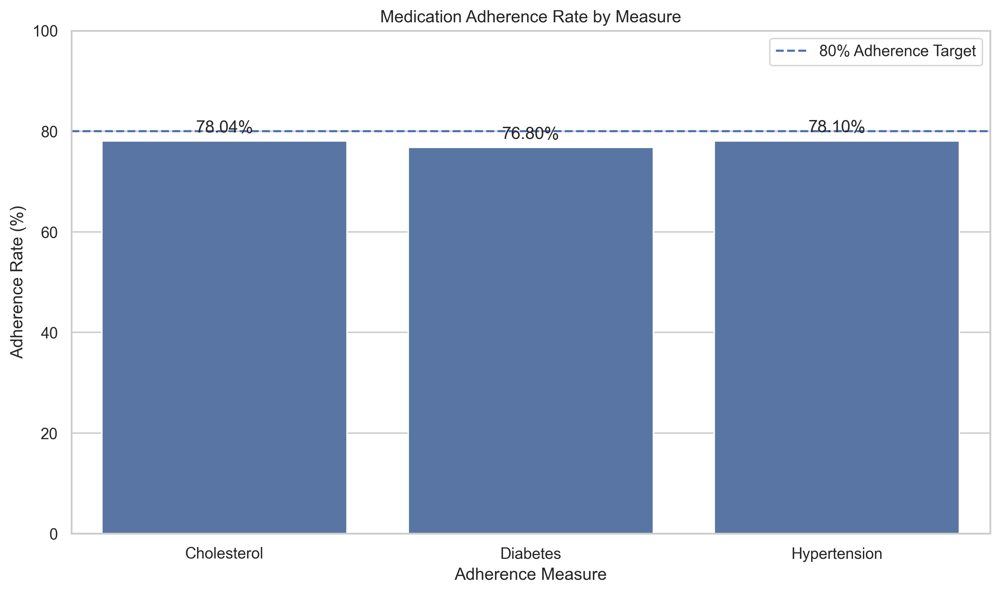
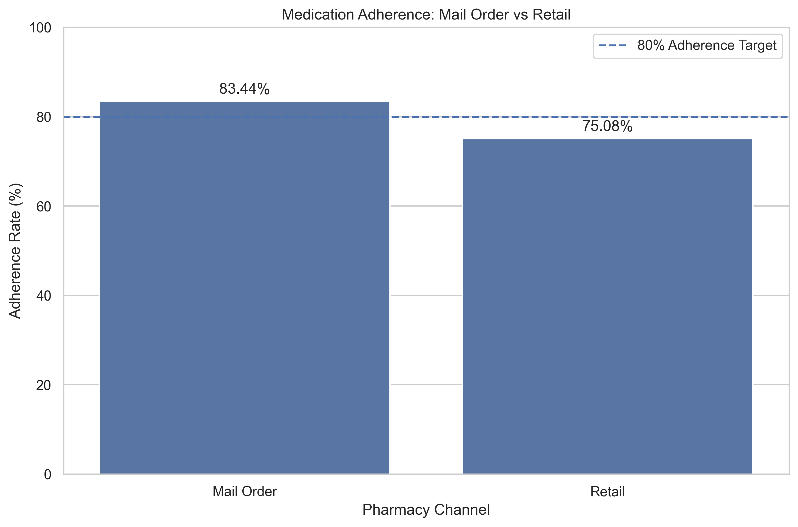
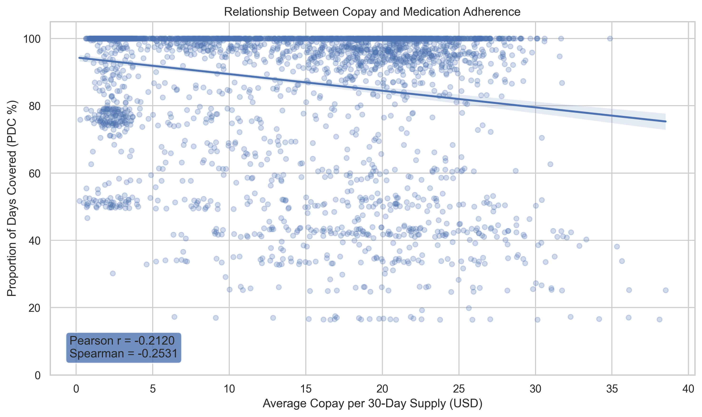
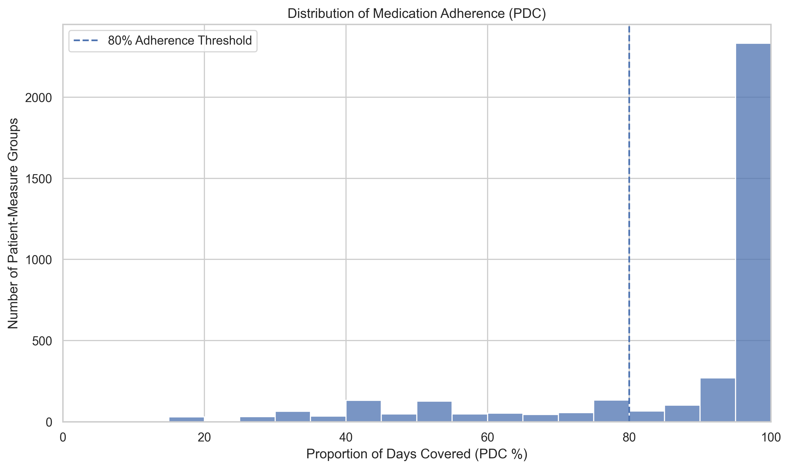

# Medication Adherence Analysis

**Healthcare analytics case study | Python · Pandas · SQL · MySQL**

An end-to-end healthcare analytics case study inspired by a pharmacy quality scenario. The project uses prescription refill records to measure medication adherence across three measures—diabetes, hypertension (RAS), and cholesterol (statins)—identify potential outreach candidates, and explore associations with pharmacy channel and copay.

## 4K Project Summary


> **Context and data note:** This is an independent, CVS Health-inspired case study. Do not describe the supplied data as CVS Health internal or patient data unless its provenance explicitly confirms that. The analysis is descriptive and does not represent official CVS Health or Medicare Star Ratings.

## Business questions

1. What proportion of days covered (PDC) did each eligible patient-measure group achieve during 2025?
2. Which adherence measure had the lowest adherence rate?
3. Did mail-order groups have higher adherence than retail groups in this dataset?
4. Was normalized copay associated with PDC?
5. Which below-threshold groups could theoretically still reach 80% by their measurement-period end date and therefore may be candidates for outreach?

## Project workflow

1. **Inspect the data:** review dimensions, columns, data types, missing values, empty strings, duplicates, category values, dates, numeric fields, and patient/refill relationships.
2. **Clean and standardize:** preserve source files, create working copies, remove 18 exact duplicate fill records from the working data, normalize drug-name text, standardize categories, and convert date/numeric fields.
3. **Integrate with MySQL:** load the cleaned reference, patient, and fill tables; join prescription fills to the drug reference to attach drug class, measure, and generic status.
4. **Define eligible refills and cohorts:** count only records with `fill_status = 'filled'` and `days_supply > 0`; require at least two eligible refills per patient and measure.
5. **Define measurement windows:** start on the first eligible refill for each patient-measure group and end on the earlier of the patient's enrollment-through date or December 31, 2025. The period is inclusive.
6. **Calculate PDC:** sort refills chronologically within each patient-measure group, carry forward unused supply when refills overlap, cap counted coverage at the measurement end, and divide covered days by measurement days.
7. **Assess outreach:** use September 30, 2025 as an explicitly assumed historical assessment date. Use only refills filled on or before that date when estimating the as-of coverage position.
8. **Explore business patterns:** compare dominant pharmacy channels and examine 30-day-equivalent copay versus PDC.
9. **Visualize and report:** create four charts and export the required CSV and summary deliverables.

## Key results

### 2025 adherence by measure

| Measure | Eligible patient-measure groups | Adherent groups | Non-adherent groups | Adherence rate |
|---|---:|---:|---:|---:|
| Cholesterol statins | 1,166 | 910 | 256 | **78.04%** |
| Diabetes | 1,207 | 927 | 280 | **76.80%** |
| Hypertension RAS | 1,192 | 931 | 261 | **78.10%** |
| **Total** | **3,565** | **2,768** | **797** | **77.66%** |

The adherence threshold is PDC ≥ 0.80. Diabetes had the lowest adherence rate in this analysis.

### Pharmacy channel comparison

Channel was assigned at the patient-measure level according to which channel supplied the greater total days supply. These are dominant-channel groups, not exclusive-use groups.

| Dominant channel | Patient-measure groups | Adherent groups | Average PDC | Adherence rate |
|---|---:|---:|---:|---:|
| Mail order | 1,093 | 912 | 93.96% | **83.44%** |
| Retail | 2,472 | 1,856 | 85.36% | **75.08%** |

Mail-order groups had an adherence rate 8.36 percentage points higher than retail groups. This is an observed association, not evidence that mail order causes better adherence.

### Copay and PDC

Copay was normalized to a 30-day supply using `copay_usd / days_supply × 30`, then averaged across eligible fills for each patient-measure group.

- Pearson correlation between average 30-day-equivalent copay and PDC: **−0.2120**
- Spearman correlation: **−0.2531**
- Lowest copay quartile adherence: **83.74%**
- Highest copay quartile adherence: **74.86%**

These results indicate a weak negative association in this dataset. They do not establish causation. Patient-measure groups may not be statistically independent because one patient can appear in more than one measure.

### Outreach opportunity

**Assessment date assumption: September 30, 2025.** The original scenario specified that the 2025 measurement period closes on December 31, but did not specify an outreach snapshot date. September 30 was selected as an analytical assumption to leave time for possible intervention before the measurement period ends.

- Active patient-measure groups at the snapshot: **3,443**
- Unique patients in those groups: **2,104**
- Eligible refill records dated on or before the snapshot: **18,331**
- Groups below 80% at the snapshot: **643**
- Groups with a theoretical maximum PDC of at least 80%: **106**
- Unique patients represented in those outreach groups: **100**

The maximum achievable PDC assumes every remaining day in the measurement period could be covered. It is a theoretical ceiling, not a prediction or guarantee of future adherence. The outreach list contains patient identifiers and should be kept private unless there is explicit authorization to share it.

## Visualizations

The charts below are saved at 300 DPI in `reports/figures/`. Copy the four PNGs generated by the notebook into that folder so GitHub can render them from these relative paths.

### 1. Adherence rate by measure



### 2. Mail order versus retail



### 3. Copay versus PDC



### 4. PDC distribution



## Repository structure

```text
Medication_Adherence_Analysis/
├── README.md
├── .gitignore
├── data/
│   ├── raw/                 # Original input files (private; do not commit)
│   └── processed/           # Cleaned patient-level data (private; do not commit)
├── notebooks/
│   ├── 01_Data_Inspection.ipynb
│   ├── 02_Data_Cleaning.ipynb
│   ├── 03_PDC_Calculation.ipynb
│   └── 04_Business_Insights.ipynb
├── outputs/                 # Patient-level CSV deliverables (private; do not commit)
├── reports/
│   ├── project_summary.md
│   └── figures/
│       ├── 01_adherence_by_measure.png
│       ├── 02_mail_order_vs_retail.png
│       ├── 03_copay_vs_pdc.png
│       └── 04_pdc_distribution.png
└── sql/                     # Save reusable SQL scripts here
```

## Tools and skills demonstrated

- Python, Pandas, and NumPy for data inspection, cleaning, date logic, cohort summaries, and PDC calculations.
- MySQL and SQL for table creation, joins, eligibility filters, grouping, and cohort construction.
- SQLAlchemy for Python-to-MySQL connectivity.
- Matplotlib and Seaborn for exploratory and business-focused visualizations.
- Jupyter Notebook for a reproducible, step-by-step workflow.

## Deliverables

The local project produces:

- `patient_adherence.csv` — patient-measure PDC and adherence classification.
- `adherence_summary.csv` — adherence summary for the three measures.
- `outreach_list.csv` — potential outreach candidates at the assumed September 30 snapshot.
- `reports/project_summary.md` — concise business findings.
- Four PNG charts under `reports/figures/`.

Patient-level files and source datasets are intentionally excluded from this public repository template. Publish only data and notebook outputs that you have permission to share. Clear sensitive cell outputs from notebooks before committing them; `.gitignore` does not remove data already embedded in notebook files.

## Limitations and interpretation

- Results depend on the supplied datasets and the stated eligibility, carry-forward, enrollment, and outreach assumptions.
- The project uses patient-measure groups for measure-level summaries; a patient can contribute to more than one measure.
- The channel comparison uses dominant days-supply channel, which is an analytical classification.
- Copay correlations are exploratory and do not show that copay causes non-adherence.
- The September 30, 2025 outreach cutoff is an assumption, not a date specified in the scenario.
- This is a portfolio case study, not clinical guidance or an official quality-rating calculation.

## Conclusion

This project demonstrates an end-to-end pharmacy analytics workflow: transforming refill records into patient-measure cohorts, calculating PDC with overlap handling, identifying possible outreach opportunities, and communicating patterns in adherence, pharmacy channel, and copay using Python and SQL.
